# Tarea 2 · Entorno móvil e inteligencia artificial con MCP

| | |
|---|---|
| **UEA y clave** | Administración de Proyectos de Software (1151055) |
| **Trimestre** | 26-O, otoño 2026 |
| **Licenciatura** | Ingeniería en Computación |
| **Nombre** | Abril Flores De Lucio |
| **Matrícula** | 2223001369 |
| **Profesor** | M. en C. Gabriel Hurtado Avilés |
| **Fecha** | 18 de octubre de 2026 |

---


## Resumen

Esta tarea tiene dos partes. En la primera dejé lista mi computadora y mi teléfono Android para desarrollar la app de navegación del proyecto: Android Studio, Flutter y Dart, y las aplicaciones de ejemplo *HolaMundoFlutter* y *HolaMundoKMP* corriendo en mi teléfono. En la segunda investigué el Model Context Protocol (MCP) y dejé funcionando el servidor de sistema de archivos en Claude Desktop, limitado a una sola carpeta, con pruebas de cada operación y del límite de seguridad.

La idea central: un modelo de lenguaje solo recibe y devuelve texto, y MCP es el protocolo que le permite descubrir herramientas y usarlas, por ejemplo para leer y modificar archivos de un proyecto, con un intermediario que ejecuta las acciones y pide permiso.

### Índice de la investigación (`docs/`)

| # | Tema | Archivo |
|---|---|---|
| 1 | Evolución de los modelos | [evolucionModelos.md](docs/evolucionModelos.md) |
| 2 | El problema del aislamiento | [problemasAislamiento.md](docs/problemasAislamiento.md) |
| 3 | MCP frente a una API | [MCPFrenteAPI.md](docs/MCPFrenteAPI.md) |
| 4 | Arquitectura | [arquitectura.md](docs/arquitectura.md) |
| 5 | El servidor de sistema de archivos | [servidorSistemaArchivos.md](docs/servidorSistemaArchivos.md) |
| 6 | Seguridad | [seguridad.md](docs/seguridad.md) |
| 7 | Casos de uso | [casosUso.md](docs/casosUso.md) |

---

## Parte 1. El entorno de desarrollo móvil

Repositorios clonados y seguidos según sus README: `gabrielhuav/Flutter-Projects` (carpeta `HolaMundoFlutter`) [2] y `gabrielhuav/HolaMundoKMP` [3].

### Versiones instaladas

| Componente | Versión |
|---|---|
| Sistema operativo | Windows 11 25H2 (compilación 10.0.26200.9457) |
| Android Studio | Android Studio Rabbit 1 \| 2026.2.1 (compilación AI-262.9437.185.2621.16467767, 29 de septiembre de 2026) · JDK incluido (JBR) 25.0.3 || Flutter | 3.47.7 (canal *stable*) |
| Dart | 3.13.5 (DevTools 2.60.0) |
| SDK de Android | Command-line Tools (latest) instaladas · Platform-Tools 37.0.1 · Emulator 37.2.12 · `flutter doctor` reporta «Android SDK version 36.0.0» |
| Otros (`flutter doctor`) | Visual Studio Build Tools 2026 18.4.2 · Chrome 155.0.8059.39 |
| Dispositivo | Xiaomi, modelo 21091116UG |
| Android del dispositivo | Android 13 (API 33) |

### Capturas

**1. Android Studio, SDK Manager con las *Command-line Tools* marcadas**

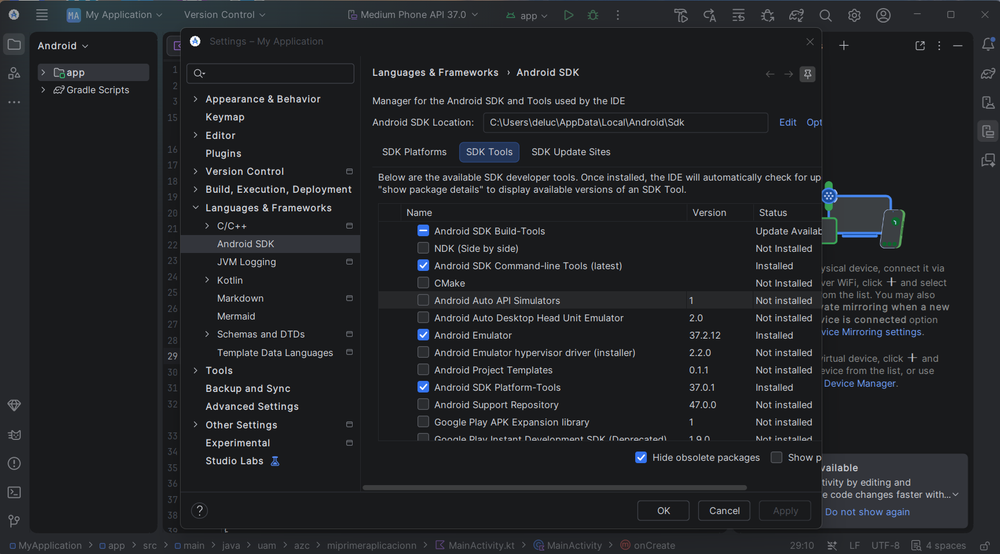

**2. `flutter --version`**

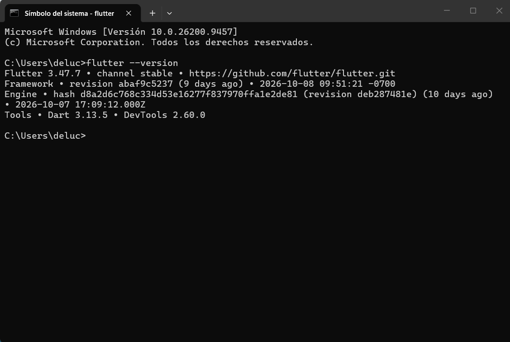

**3. `flutter doctor` con [√] en Flutter y en Android toolchain**

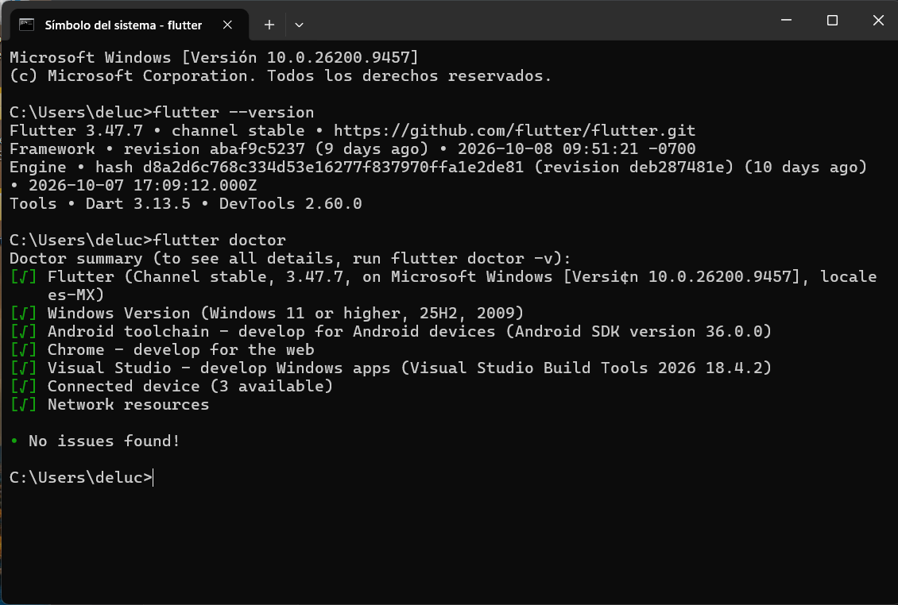

**4. Modo desarrollador del teléfono y `flutter devices`.** Depuración USB activada y el teléfono en la lista de dispositivos (usé teléfono físico, no emulador).

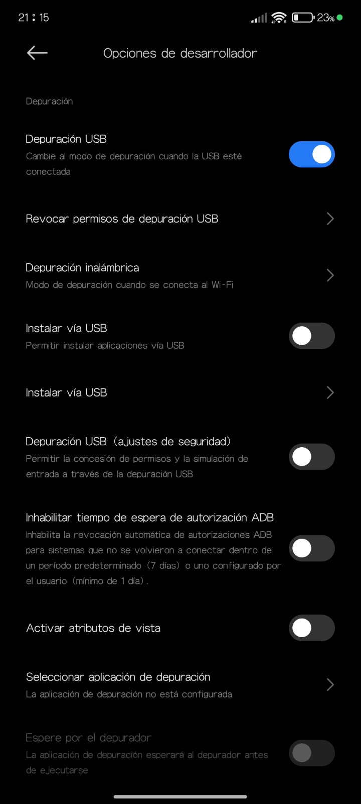

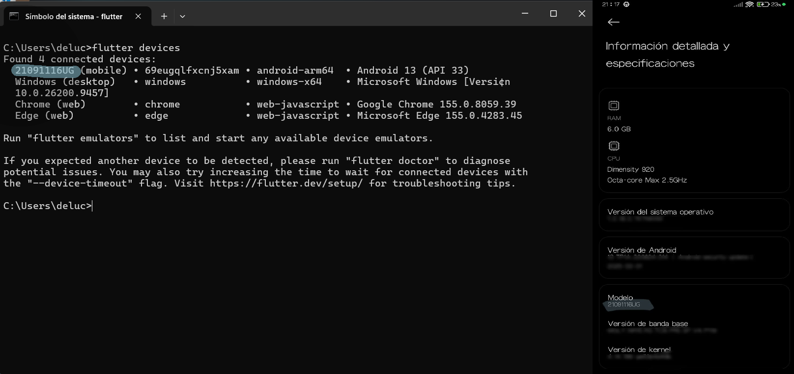

**5. HolaMundoFlutter corriendo en el teléfono**

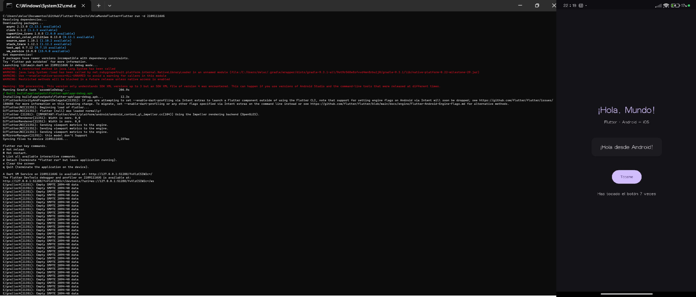

**6. HolaMundoKMP corriendo en el teléfono, desde Android Studio**

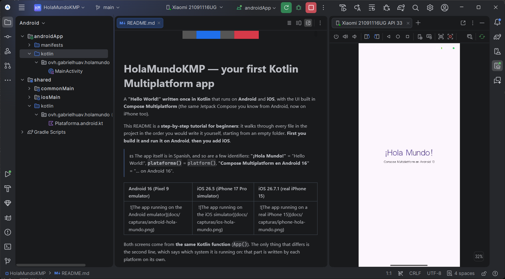

---

## Parte 2. MCP: resumen de la investigación

Versión de la especificación consultada: **MCP 2026-07-28**, consultada el 18 de octubre de 2026 [7]. La especificación cambia seguido; los detalles y las fuentes de cada afirmación están en `docs/`. Como punto de partida vi el video «Diferencia entre API y MCP» [8].

### MCP frente a una API

Una API es un contrato entre programas: quien programa decide de antemano qué se llama y cuándo. MCP es un protocolo abierto sobre JSON-RPC 2.0 en el que un servidor publica un catálogo de herramientas y el modelo lo descubre en el momento y decide cuál usar [5][7].

| Criterio | API tradicional | MCP |
|---|---|---|
| **Quién decide qué se invoca** | El programador, en el código, de antemano | El modelo, en tiempo de ejecución, entre las herramientas publicadas |
| **Cómo se descubren las capacidades** | Documentación o esquema (por ejemplo OpenAPI) que lee una persona o un generador de código | El cliente pide el catálogo al servidor (`tools/list`) y lo descubre al conectar |
| **Acoplamiento** | Alto: cada aplicación se integra a mano con cada API | Bajo: cualquier cliente compatible usa cualquier servidor compatible |
| **Formato de los mensajes** | Depende de cada API (REST con JSON, GraphQL, SOAP…) | JSON-RPC 2.0 |
| **Autenticación y consentimiento** | Lo define cada API (claves, OAuth…); el consentimiento lo resuelve la aplicación | Autorización definida para el transporte HTTP; con stdio, las credenciales se toman del entorno. La especificación recomienda que un humano pueda negar las llamadas |
| **Reutilización entre aplicaciones** | Baja: la integración se reescribe en cada aplicación | Alta: un mismo servidor sirve a muchos clientes |

**MCP no sustituye a las APIs: casi siempre envuelve una que ya existe.** Lo que añade es una capa uniforme para que un modelo descubra y use esas capacidades sin que alguien programe cada integración. Detalle y fuentes en [MCPFrenteAPI.md](docs/MCPFrenteAPI.md).

### Arquitectura en lo que instalé

El host crea un cliente MCP por cada servidor al que se conecta [5]. En la revisión 2026-07-28 el protocolo pasó a ser sin estado y se marcaron como deprecados *Roots*, *Sampling* y *Logging* [6].

| Rol | Quién es |
|---|---|
| Host | Claude Desktop |
| Cliente MCP | El componente MCP dentro de Claude Desktop (uno por servidor) |
| Servidor MCP | `@modelcontextprotocol/server-filesystem`, proceso local lanzado por `npx` |
| Transporte | stdio |

---

## Parte 3. MCP: implementación

El servidor de sistema de archivos no forma parte del protocolo: es uno de los servidores de referencia del proyecto [4].

### Cliente elegido: Claude Desktop

Lo elegí porque se configura con un solo archivo JSON (fácil de reproducir), porque su interfaz muestra el servidor, sus herramientas y el permiso de cada una, y porque pide confirmación antes de ejecutar una herramienta. La justificación completa está en [casosUso.md](docs/casosUso.md#73-mi-caso).

### Requisitos

| Elemento | Versión |
|---|---|
| Sistema operativo | Windows 11 25H2 |
| Node.js (incluye `npx`) | 24.14.1 |
| Claude Desktop | 2.42304.0 (e7f60e) |
| Modelo usado en el chat | Claude Sonnet 5.5 || `@modelcontextprotocol/server-filesystem` | 1.0.0 |
| Especificación MCP consultada | 2026-07-28 |

### Instalación paso a paso (reproducible en una máquina limpia)

1. **Crear la carpeta autorizada.** En PowerShell:
   ```powershell
   mkdir C:\mcp-tarea2
   Set-Content C:\mcp-tarea2\notas.txt "HOLA"
   ```
   Esta carpeta es el único lugar al que tendrá acceso el servidor. No uso la raíz del disco ni mi carpeta de usuario.

2. **Instalar Node.js (versión LTS)** desde nodejs.org y comprobar:
   ```powershell
   node --version
   npx --version
   ```

3. **Instalar Claude Desktop** para Windows e iniciar sesión.

4. **Agregar el servidor.** En Claude Desktop, en *Configuración → Desarrollador*, abrir el archivo de configuración (`claude_desktop_config.json`, normalmente en `%APPDATA%\Claude\`) y dejarlo así (copia en [`config/claude_desktop_config.json`](config/claude_desktop_config.json); no contiene credenciales):

   ```json
   {
     "mcpServers": {
       "filesystem": {
         "command": "npx",
         "args": [
           "-y",
           "@modelcontextprotocol/server-filesystem",
           "C:\\mcp-tarea2"
         ]
       }
     }
   }
   ```

   - En Windows las diagonales invertidas van dobles (`C:\\mcp-tarea2`) o se usan diagonales normales (`C:/mcp-tarea2`).
   - El último argumento es el **directorio permitido**: el límite de seguridad del servidor.
   - `npx -y` descarga la versión más reciente del servidor cada vez que se inicia. Para reproducibilidad se puede fijar la versión (`@modelcontextprotocol/server-filesystem@<versión>`).

5. **Reiniciar Claude Desktop por completo** (salir desde el ícono de la bandeja del sistema y volver a abrirlo).

6. **Comprobar que el cliente lo reconoce y lista sus herramientas.** El conector `filesystem` aparece activado en el menú de conectores y en *Configuración → Conectores*, y sus herramientas aparecen agrupadas, con permisos por herramienta.

   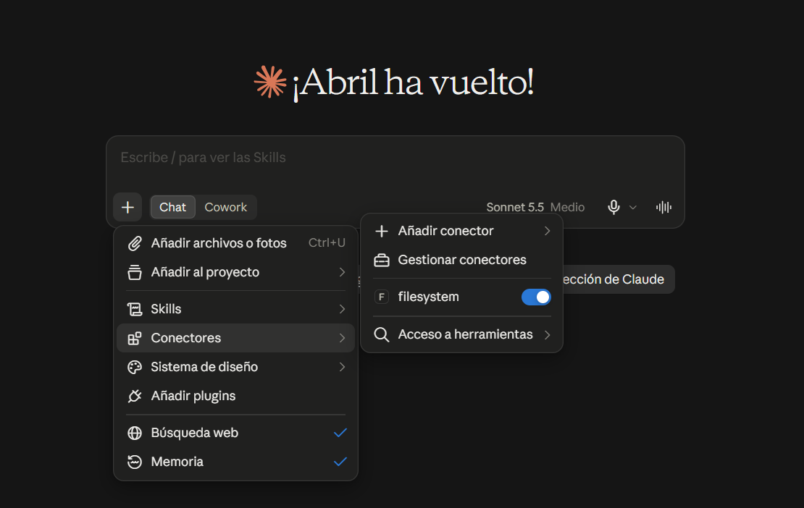

   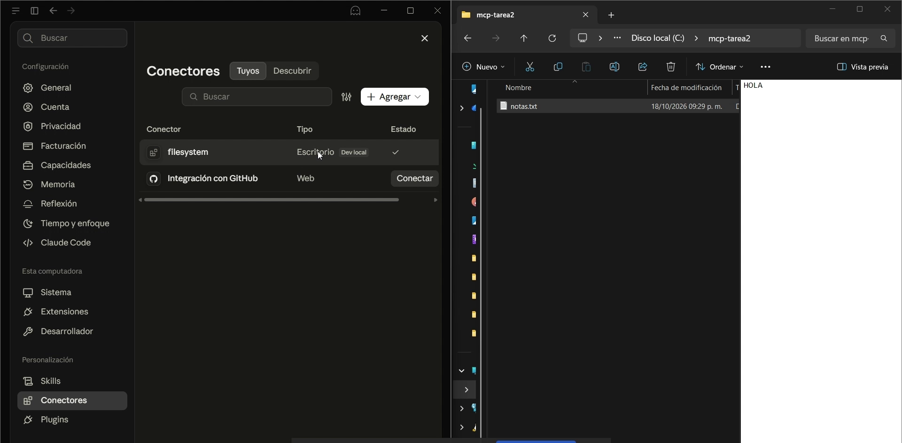

   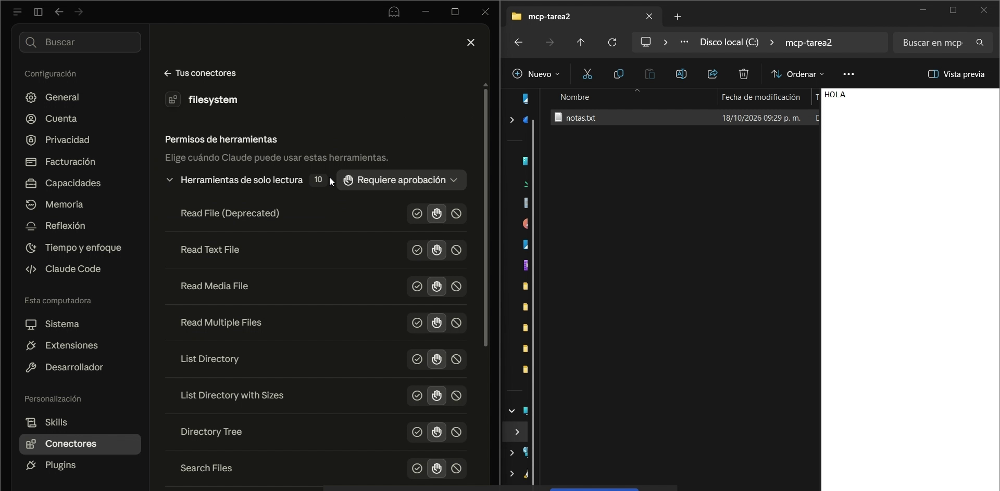

   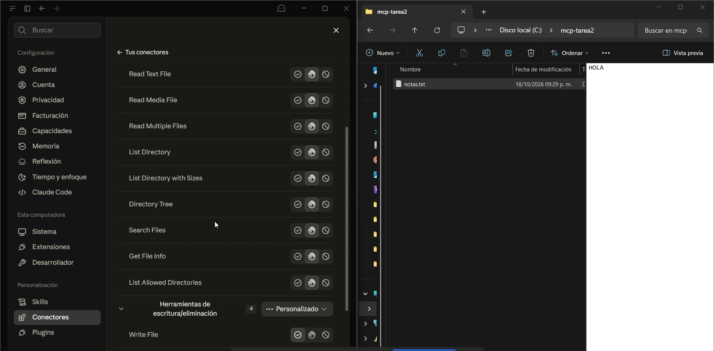

   Antes de ejecutar una herramienta, Claude Desktop pide confirmación (*Denegar*, *Permitir siempre* o *Permitir una vez*):

   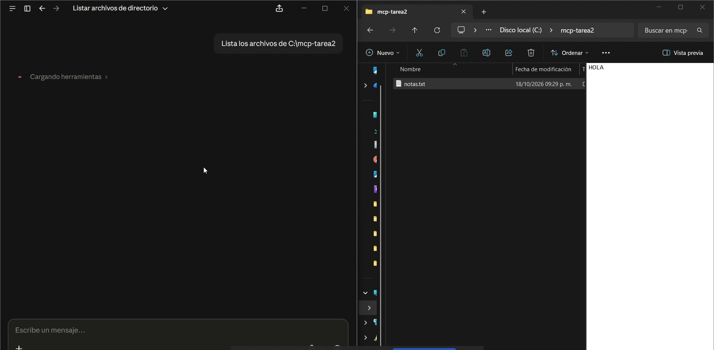

### Operaciones sobre la carpeta autorizada

Cada operación se pidió en lenguaje natural; el modelo eligió la herramienta del servidor.

| Operación | Lo que pedí | Qué pasó |
|---|---|---|
| Listar | «Lista los archivos de C:\mcp-tarea2» | Usó `List Directory` y respondió que había un solo archivo, `notas.txt`. |
| Leer | (al crear el resumen) | Usó `Read Text File` y leyó `notas.txt`, cuyo contenido era «HOLA». |
| Crear | «Crea un archivo prueba.md con un resumen de dos líneas» | Usó `Write File` y creó `C:\mcp-tarea2\prueba.md`; apareció en el Explorador de archivos. |
| Modificar | «Modifica notas.txt y agrega una línea al final» | Usó `Write File`; `notas.txt` quedó con «HOLA» y una segunda línea agregada por Claude (de 4 a 46 bytes). |
| Buscar | «Busca los archivos que contengan la palabra 'MCP'» | Explicó que la búsqueda del servidor es solo por nombre de archivo; leyó los archivos con `Read Multiple Files` y encontró «MCP» en `notas.txt` y `prueba.md`. |

**Listar**

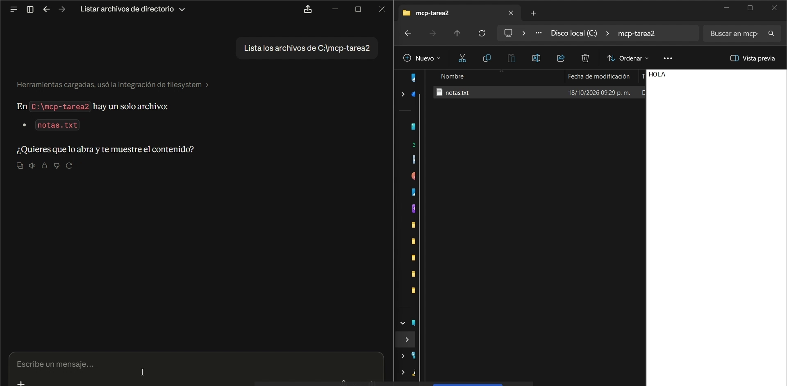

**Leer**

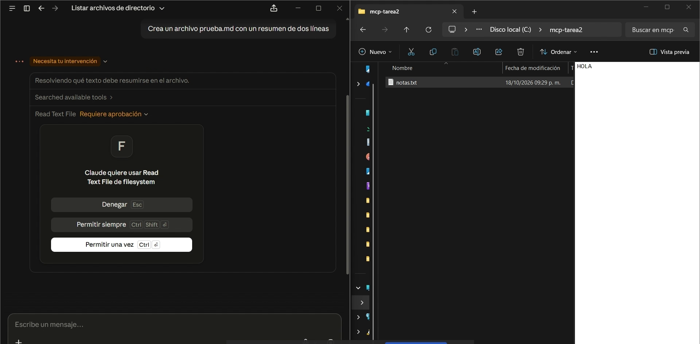

**Crear**

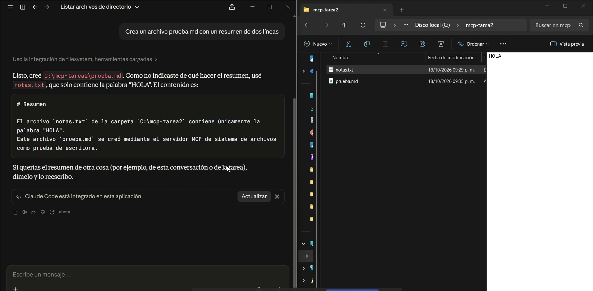

**Modificar**

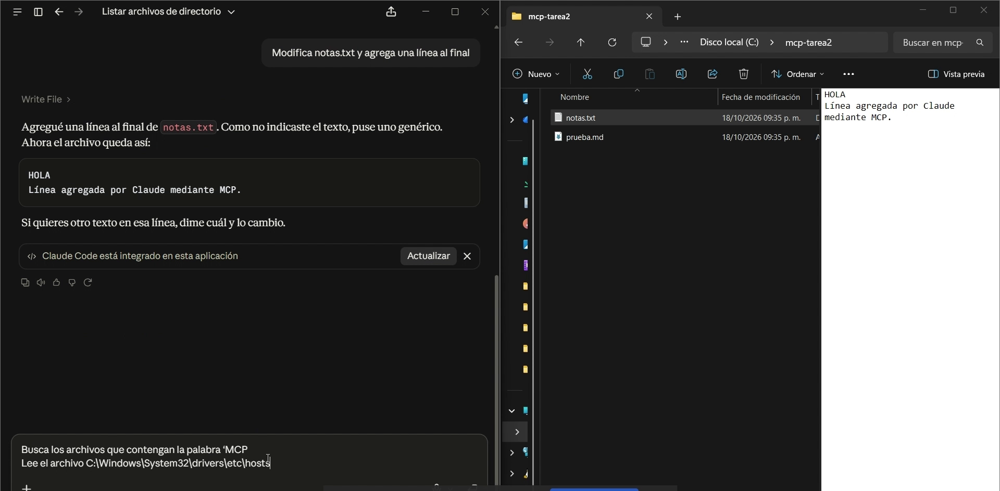

**Buscar**

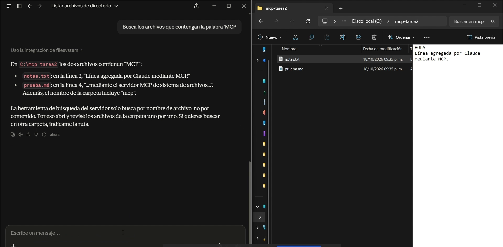

### El límite de seguridad

Le pedí al modelo: «Lee el archivo C:\Windows\System32\drivers\etc\hosts», que está fuera de la carpeta autorizada.

- **Qué respondió:** que no pudo leerlo, porque el servidor de sistema de archivos solo tiene acceso a `C:\mcp-tarea2` y sus subcarpetas. Sugirió abrir el archivo yo mismo o copiarlo a la carpeta permitida, y desaconsejó ampliar los directorios permitidos solo para esto.
- **Qué lo impidió:** la restricción de directorios permitidos del servidor, definida en el argumento de la configuración. La llamada a la herramienta apareció como «Fallido»: no fue una decisión del modelo, el servidor rechazó la ruta.

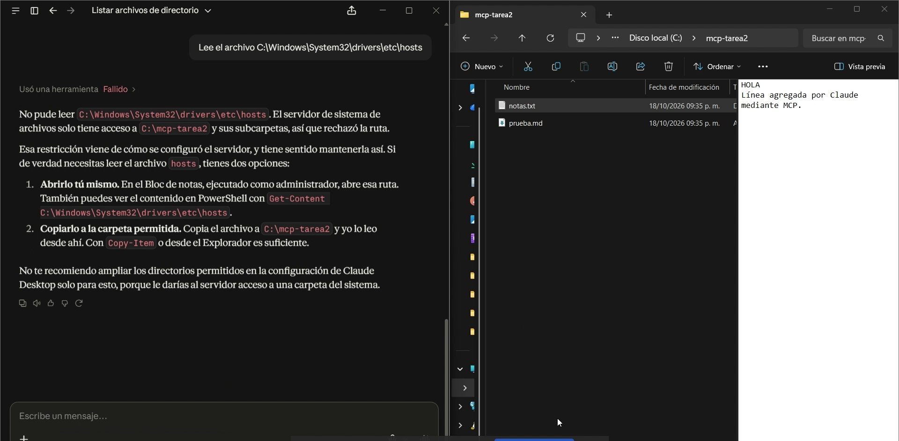

Más detalle sobre riesgos y mitigaciones en [seguridad.md](docs/seguridad.md).

---

## Conclusiones

- Un modelo de lenguaje, por sí solo, recibe texto y devuelve texto. MCP resuelve el aislamiento poniendo un intermediario que expone herramientas acotadas, las ejecuta localmente y pide permiso.
- La diferencia con una API es quién decide: en una API, el programador fija qué se llama; en MCP, el servidor publica un catálogo y el modelo elige en el momento. Además, MCP no reemplaza a las APIs: normalmente las envuelve.
- El servidor de sistema de archivos solo puede hacer lo que le permiten los directorios autorizados. La prueba con `hosts` lo comprobó: pedir un archivo fuera de la carpeta falló en el servidor, no por criterio del modelo.
- La seguridad depende de varias capas: alcance limitado a una carpeta dedicada, confirmación humana, revisar lo que expone el servidor y mantenerlo actualizado, porque en 2025 se encontraron fallos que permitían salirse de la carpeta autorizada [1].

---

## Referencias

[1] Cymulate Research Labs. (2025). *EscapeRoute: Breaking the scope of Anthropic's Filesystem MCP Server (CVE-2025-53109 & CVE-2025-53110)*. Cymulate. https://cymulate.com/blog/cve-2025-53109-53110-escaperoute-anthropic/

[2] Hurtado Avilés, G. (2026a). *HolaMundoFlutter* [Software]. GitHub. https://github.com/gabrielhuav/Flutter-Projects/tree/main/HolaMundoFlutter

[3] Hurtado Avilés, G. (2026b). *HolaMundoKMP* [Software]. GitHub. https://github.com/gabrielhuav/HolaMundoKMP

[4] Model Context Protocol. (s. f.). *Filesystem MCP Server* [Repositorio]. GitHub. https://github.com/modelcontextprotocol/servers/tree/main/src/filesystem

[5] Model Context Protocol. (2026a). *Architecture overview*. https://modelcontextprotocol.io/docs/2026-07-28/learn/architecture

[6] Model Context Protocol. (2026b). *Key changes* (Specification 2026-07-28, changelog). GitHub. https://github.com/modelcontextprotocol/modelcontextprotocol/blob/main/docs/specification/2026-07-28/changelog.mdx

[7] Model Context Protocol. (2026c, 28 de julio). *Specification* (Versión 2026-07-28). https://modelcontextprotocol.io/specification/2026-07-28

[8] Vida MRR - Programacion web. (s. f.). *Diferencia entre API y MCP* [Video]. YouTube. https://youtu.be/FdVkE8u2C_Q

## Declaración de uso de inteligencia artificial
Utilicé Claude (Anthropic) para realizar esta investigación.