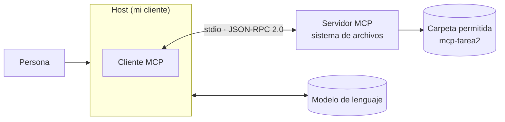

# 4. Arquitectura de MCP

*Tarea 2 · Administración de Proyectos de Software (1151055) · UAM Azcapotzalco · 26-O*

> **Versión de la especificación consultada:** MCP **2026-07-28**, publicada como versión estable el 28 de julio de 2026. Consultada el **18 de octubre de 2026** [4][1]. La especificación cambia seguido: las versiones anteriores (por ejemplo 2025-11-25) difieren en varios puntos que se señalan abajo.
> **Mi instalación:** Claude Desktop 2.42304.0 (e7f60e) en Windows 11, con `@modelcontextprotocol/server-filesystem` 1.0.0, y Claude Sonnet 5.5 como modelo del chat. No verifiqué qué versión del protocolo negocian entre sí cliente y servidor; por eso solo reporto la de la especificación que consulté.

## 4.1 Host, cliente y servidor

MCP sigue una arquitectura cliente-servidor con tres participantes [2]:

- **Host:** la aplicación de IA con la que trabaja la persona (la documentación menciona Claude Code y Claude Desktop como ejemplos). El host crea **un cliente MCP por cada servidor** al que se conecta.
- **Cliente MCP:** componente dentro del host que mantiene una conexión dedicada con un servidor.
- **Servidor MCP:** programa que expone herramientas y datos. Puede ejecutarse localmente o de forma remota.

**En esta tarea:**

| Rol | Quién es en mi instalación |
|---|---|
| Host | Claude Desktop (aplicación de escritorio en Windows 11) |
| Cliente MCP | El componente MCP dentro de ese host |
| Servidor MCP | `@modelcontextprotocol/server-filesystem`, que corre en mi máquina como proceso local |

## 4.2 Primitivas

**Del servidor** (lo que ofrece) [2]:

| Primitiva | Qué es |
|---|---|
| *Tools* | Acciones que el modelo puede ejecutar (por ejemplo, leer o escribir un archivo) |
| *Resources* | Datos de contexto que el servidor pone a disposición |
| *Prompts* | Plantillas de interacción reutilizables |

**Del cliente** (lo que ofrece al servidor):

| Primitiva | Qué es |
|---|---|
| *Roots* | Indica al servidor en qué carpetas o recursos puede operar |
| *Elicitation* | Permite que el servidor le pida información adicional a la persona usuaria a través del cliente |

> **Cambios en la revisión 2026-07-28:** el registro de cambios marca como **deprecados** *Roots*, *Sampling* y *Logging* [3][1]; para sustituir *Roots* se sugiere pasar directorios o archivos por parámetros de herramientas, URI de recursos o configuración del servidor [3]. *Elicitation* **no** está en la lista de deprecados, pero cambió la forma de pedirla: ahora se usa el patrón de *Multi Round-Trip Requests* (el servidor responde que necesita más información y el cliente reintenta la petición original con la respuesta), y se eliminó la notificación `notifications/elicitation/complete` [3].

## 4.3 Transportes

La especificación define dos transportes estándar [6]:

| Transporte | Cómo funciona | Cuándo se usa |
|---|---|---|
| **stdio** | Mensajes JSON-RPC delimitados por salto de línea a través de la entrada y salida estándar; el cliente lanza el servidor como subproceso [6][2] | Servidores locales, como el de sistema de archivos |
| **Streamable HTTP** | Peticiones HTTP; el servidor es un proceso independiente que atiende a varios clientes [5][2] | Servidores remotos |

Streamable HTTP se introdujo en la revisión 2025-03-26 para reemplazar al transporte HTTP+SSE [5]. En la revisión 2026-07-28 el protocolo pasó a ser **sin estado**: se eliminaron las sesiones y cada petición lleva su propia versión de protocolo y capacidades [3][5].

## Referencias

[1] Model Context Protocol. (2026a, 21 de mayo). *The 2026-07-28 MCP specification release candidate* [Entrada de blog]. https://blog.modelcontextprotocol.io/posts/2026-07-28-release-candidate/

[2] Model Context Protocol. (2026b). *Architecture overview*. https://modelcontextprotocol.io/docs/2026-07-28/learn/architecture

[3] Model Context Protocol. (2026c). *Key changes* (Specification 2026-07-28, changelog). GitHub. https://github.com/modelcontextprotocol/modelcontextprotocol/blob/main/docs/specification/2026-07-28/changelog.mdx

[4] Model Context Protocol. (2026d, 28 de julio). *Specification* (Versión 2026-07-28). https://modelcontextprotocol.io/specification/2026-07-28

[5] Model Context Protocol. (2026e). *Streamable HTTP* (Specification 2026-07-28). https://modelcontextprotocol.io/specification/2026-07-28/basic/transports/streamable-http

[6] Model Context Protocol. (2026f). *Transports* (Specification 2026-07-28). https://modelcontextprotocol.io/specification/2026-07-28/basic/transports